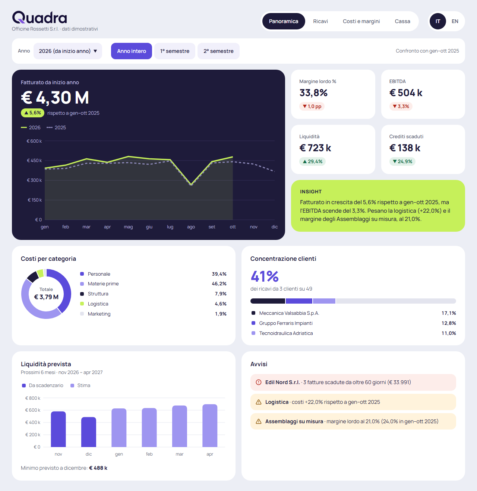
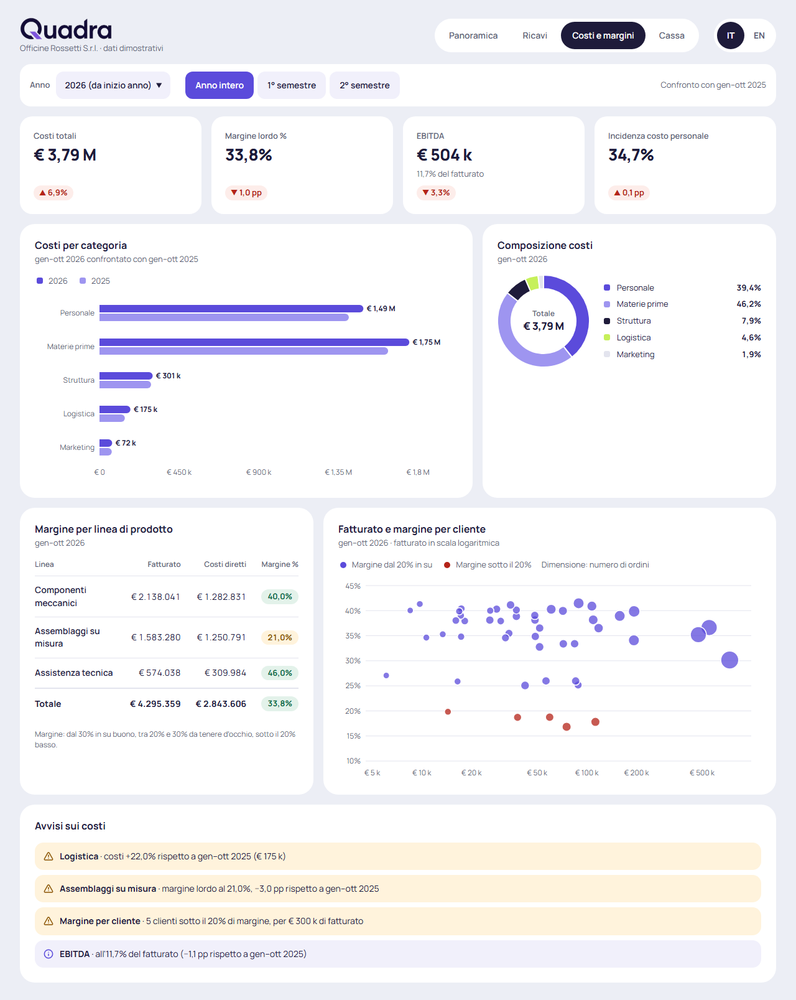
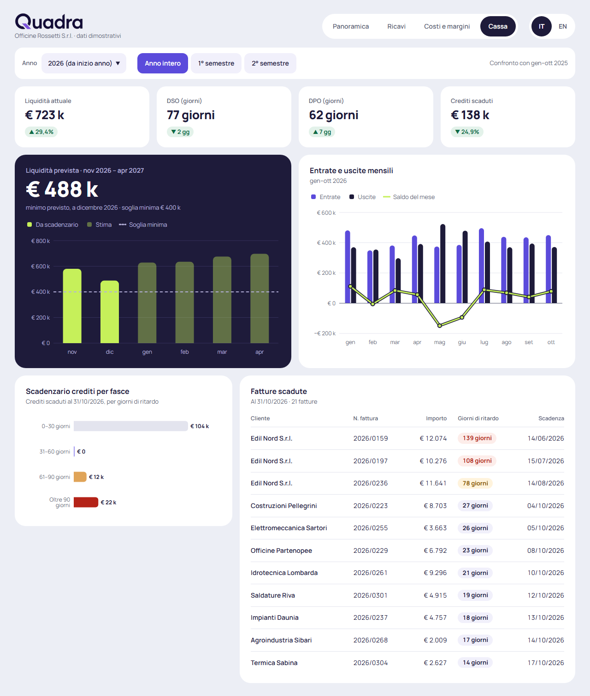
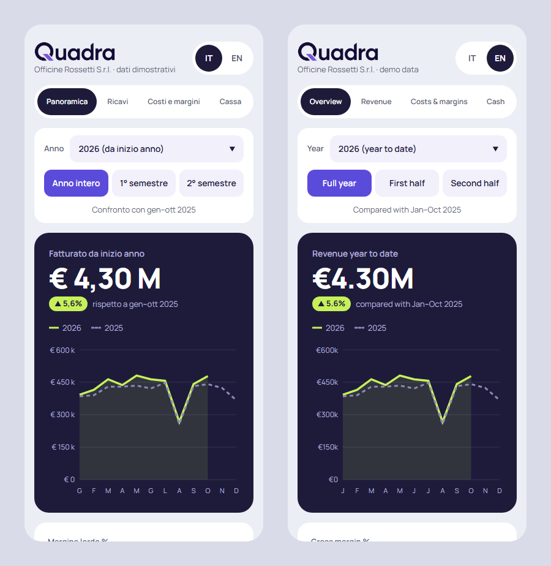

# Quadra

Dashboard di analisi dati per un'azienda immaginaria, **Officine Rossetti S.r.l.**: una PMI manifatturiera da circa 5 M€ l'anno con una cinquantina di clienti. Ha quattro pagine (Panoramica, Ricavi, Costi e margini, Cassa) con **KPI, grafici, filtri di periodo e avvisi generati dai dati**, in italiano e inglese, con card bianche e una card scura «hero» su fondo grigio-lavanda.



**Demo online:** il sito è pubblicato con GitHub Pages; il link è nella sezione *About* di questo repository.

> **Progetto dimostrativo.** L'azienda e i suoi clienti non esistono e non c'è un backend: i numeri vengono da un generatore deterministico che gira nel browser, serviti da una API simulata con una breve attesa. Nessun dato lascia il browser; l'unica cosa salvata è la lingua scelta.

## Funzionalità

- **Quattro pagine**:

  | Pagina | Percorso | Contenuto |
  |---|---|---|
  | Panoramica | `/` | fatturato con l'andamento mensile, 4 KPI, insight, costi, concentrazione clienti, liquidità prevista, avvisi |
  | Ricavi | `/ricavi` | fatturato mensile, per linea di prodotto e per area, i 10 clienti principali, stagionalità di quattro anni |
  | Costi e margini | `/costi` | costi per categoria e loro composizione, margine per linea, fatturato e margine per cliente, avvisi sui costi |
  | Cassa | `/cassa` | liquidità prevista a sei mesi con la soglia minima, entrate e uscite, scadenzario dei crediti, fatture scadute |

- **Filtri di anno e periodo** (anno intero, 1° o 2° semestre), validi per tutte le pagine. Stanno nella query string (`/ricavi?anno=2025&periodo=h1`): si possono condividere e sopravvivono al ricaricamento e al tasto indietro. Ogni dato si confronta con lo stesso periodo dell'anno prima. Un valore non valido in un link (`?anno=1999`) ricade sul default e la barra dei filtri lo dice.
- **KPI cliccabili**: ogni KPI porta alla card che la approfondisce (Margine lordo → `/costi#margini-linea`), con i filtri conservati. La card si evidenzia per un attimo. Le variazioni sono verdi o rosse secondo la metrica: più costi è un peggioramento, più ricavi un miglioramento.
- **Insight e avvisi** scritti a partire dai numeri del periodo: cambiano con i filtri. Gli avvisi sono ordinati per gravità.
- **Grafici** con legenda, tooltip e una descrizione per i lettori di schermo costruita dai dati.
- **Caricamento visibile**: a ogni cambio di filtro o di lingua le card mostrano uno skeleton finché l'API non risponde. Se la risposta fallisce, la pagina mostra l'errore e un pulsante «Riprova».
- **Italiano e inglese** con un selettore nell'header. La scelta resta salvata nel browser. Testi, grafici, valute e date cambiano subito, senza ricaricare la pagina.
- **Responsive**, da 320px in su: sotto i 900px le card vanno in colonna e le tabelle scorrono in orizzontale.
- **Accessibile**: contrasti WCAG AA, variazioni comunicate anche da frecce e testo, grafici con descrizione, animazioni spente con «riduci movimento» attivo nel sistema.

| Costi e margini | Cassa |
|---|---|
|  |  |



## Tecnologie

[React 19](https://react.dev) · [TypeScript](https://www.typescriptlang.org) · [Vite](https://vite.dev) · [React Router](https://reactrouter.com) · [Tailwind CSS 4](https://tailwindcss.com) · [Recharts](https://recharts.org) · [i18next](https://www.i18next.com) · [Lucide](https://lucide.dev) · [oxlint](https://oxc.rs)

## Avvio

Serve [Node.js](https://nodejs.org) 20.19+ o 22.12+.

```bash
npm install
npm run dev      # server di sviluppo su http://localhost:5173
npm run build    # controllo dei tipi + build di produzione in dist/
npm run preview  # serve la build di produzione
npm run lint     # oxlint
```

Per aprire il sito direttamente in una lingua: `http://localhost:5173/?lng=en`.

## Come funzionano i dati simulati

`src/api/dashboard.ts` imita un piccolo backend con quattro funzioni asincrone, una per pagina: `getOverview`, `getRevenue`, `getCosts` e `getCash`. Ognuna riceve i filtri (`{ year, period }`), attende tra 0,3 e 0,6 secondi per simulare la rete e restituisce i dati della pagina, già aggregati. Nessuna chiamata esce dal browser.

- **Errori tipizzati**: come farebbe un server, l'API controlla i filtri e fallisce con `InvalidFiltersError` se l'anno non ha dati o il periodo non ha ancora mesi chiusi.
- **Richieste annullabili**: come `fetch`, ogni funzione accetta un `AbortSignal`. `useQuadraData` annulla la richiesta superata quando filtri o lingua cambiano prima della risposta: dopo cambi rapidi vince sempre l'ultima, e una risposta vecchia non sovrascrive quella nuova.
- **Per passare a un'API reale** basta che le quattro funzioni facciano una `fetch` (es. `GET /api/overview?anno=2026&periodo=full`) e restituiscano gli stessi tipi di `src/data/types.ts`: pagine e componenti non cambiano.

I numeri vengono da `src/data/`:

- **Data di riferimento**: il mese in corso, in ora italiana. I dati arrivano alla fine del mese scorso, l'ultimo chiuso: a novembre 2026 l'anno corrente è «2026 (da inizio anno)», cioè gennaio–ottobre, e si confronta con gennaio–ottobre 2025. Si possono scegliere i tre anni precedenti. A gennaio l'anno dei dati è quello appena chiuso, completo. Il 2° semestre si può scegliere solo quando luglio è chiuso.
- **Determinismo**: ogni valore dipende solo da cliente, mese e grandezza, attraverso un hash (`data/random.ts`), non da `Math.random`: nello stesso mese i numeri sono sempre gli stessi. Varia solo l'attesa dell'API. Il dataset si genera una volta, al caricamento della pagina.
- **Contenuto**: vendite per cliente, linea di prodotto e mese; una fattura per cliente e mese, con scadenza e data di incasso; costi indiretti mensili; movimenti di cassa (stipendi su 13 mensilità, materie prime pagate a 60–90 giorni, rata del finanziamento, imposte, dividendi, un investimento).
- **Anomalie** rispetto all'anno corrente, perché insight e avvisi abbiano qualcosa da dire: agosto a circa −40% sulla media degli altri mesi; i primi tre clienti al 41% dei ricavi; gli Assemblaggi su misura al 21% di margine lordo (24% l'anno prima); la logistica +22%; un cliente, Edil Nord, che smette di pagare e poi di ordinare, con tre fatture scadute da oltre 60 giorni.
- **Coerenza**: tutte le pagine usano le stesse aggregazioni (`data/aggregate.ts`) sullo stesso periodo, quindi i totali coincidono per costruzione. Il fatturato della Panoramica è la somma per linea, per area e per cliente; la somma delle fasce dello scadenzario è il totale delle fatture scadute.

| Grandezza | Calcolo |
|---|---|
| Margine lordo | fatturato − costi diretti (materie prime + manodopera diretta) |
| EBITDA | fatturato − costi diretti − costi indiretti |
| DSO | crediti / fatturato degli ultimi 12 mesi × 365 |
| DPO | debiti verso fornitori / acquisti degli ultimi 12 mesi × 365 |

Liquidità, crediti, DSO e DPO si leggono alla fine dell'ultimo mese chiuso del periodo. La liquidità prevista copre i sei mesi dopo l'ultimo mese chiuso e non dipende dai filtri: i primi due mesi vengono da incassi e pagamenti già noti, gli altri sono una stima. Tutti gli importi sono al netto dell'IVA.

Le soglie con cui la dashboard giudica i numeri sono definite una volta sola, in `src/data/rules.ts`: fasce del margine (30% e 20%), fasce dello scadenzario (30, 60, 90 giorni), ritardo che rende critico un avviso, crescita dei costi che fa scattare un avviso, numero di clienti principali. La logica le usa per colori e avvisi, i testi le ricevono come parametri: la legenda «Margine sotto il 20%», le etichette «61–90 giorni» e la nota sotto la tabella dei margini si aggiornano da sole se cambiano.

## Struttura

```
src/
  main.tsx                 punto di ingresso: stile, i18n, router e App
  App.tsx                  rotte: /, /ricavi, /costi, /cassa
  QuadraLayout.tsx         header, barra dei filtri e pagina
  quadra.css               Tailwind con il tema (token, raggi, corpi, varianti responsive)
  routes.ts                percorsi e id delle sezioni (gli hash a cui portano le KPI)
  api/
    dashboard.ts           API simulata: i dati delle quattro pagine, InvalidFiltersError
    mock.ts                attesa simulata annullabile
  assets/header.webp       scritta «Quadra» nell'header
  components/
    QuadraHeader.tsx, QuadraNav.tsx, LanguageSwitch.tsx, FilterBar.tsx
    Card, KpiCard, KpiRow, DeltaBadge, InsightCard, AlertList, StatusChip, Skeleton, LoadError…
    charts/                stile comune, legenda, tooltip, ciambella, barre della previsione
    overview/, revenue/, costs/, cash/   le card di ogni pagina
  data/
    calendar.ts            mese di riferimento, anni, periodi e loro etichette
    company.ts             azienda, linee, categorie, aree, clienti (inventati), obiettivi del generatore
    generate.ts            il dataset di base, deterministico
    aggregate.ts           aggregazioni pure
    views.ts               i dati di ogni pagina per il periodo scelto
    insights.ts            testo dell'insight e avvisi
    kpis.ts                formato, polarità e destinazione di ogni KPI
    rules.ts               soglie (margini, scadenzario, avvisi)
    random.ts, types.ts
  i18n/
    index.ts               configurazione di i18next
    locale.ts              lingua attiva, locale per Intl, helper per i testi
  locales/
    it.json, en.json       tutti i testi
  pages/                   QuadraOverview, QuadraRevenue, QuadraCosts, QuadraCash, layout.ts
  utils/format.ts          valute, percentuali, giorni, date e mesi nella lingua attiva
  useQuadraData.ts         chiama l'API a ogni cambio di filtri o lingua: dati, skeleton, errore
  useQuadraFilters.ts      filtri nella query string
  useScrollToHash.ts, useMediaQuery.ts
public/favicon.webp        icona del sito
docs/screenshots/          immagini di questo README
.github/workflows/deploy.yml   pubblicazione automatica su GitHub Pages
```

## Pubblicazione su GitHub Pages

Il workflow `.github/workflows/deploy.yml` pubblica il sito a ogni push sul branch `main`. Si può anche avviare a mano dalla scheda *Actions*. Il workflow installa le dipendenze, esegue il build e carica la cartella `dist/` su GitHub Pages.

Il sito viene servito da un sottopercorso, `https://<utente>.github.io/<nome-repository>/`. Per questo:

- il build riceve quel percorso come `base` (`--base=/<nome-repository>/`), letto dal nome del repository: se il repository viene rinominato, il workflow continua a funzionare;
- il router usa lo stesso percorso come `basename` (`import.meta.env.BASE_URL` in `main.tsx`);
- dopo il build, `dist/index.html` viene copiato in `dist/404.html`. GitHub Pages risponde con quella pagina a ogni percorso che non è un file, come `/quadra/cassa`: così anche un link diretto o un ricaricamento su una pagina interna aprono la pagina giusta, filtri e ancora compresi.

Configurazione, una sola volta: *Settings → Pages → Build and deployment → Source: **GitHub Actions***.

## Lingua

La lingua viene scelta in quest'ordine: il parametro `?lng=it` / `?lng=en` nell'URL, poi la scelta fatta con il selettore (salvata nel `localStorage` alla chiave `quadra:lang`), infine la lingua del browser. Se nessuna corrisponde, il sito è in italiano. Scegliendo dal selettore, un eventuale `?lng=` sparisce dall'URL.

I testi stanno in `src/locales/it.json` e `src/locales/en.json` (namespace `quadra`). I due file hanno la stessa struttura di chiavi. Il dataset contiene solo numeri e id: linee, categorie, aree, fasce e KPI hanno l'etichetta alla chiave del loro id. Insight e avvisi sono modelli con segnaposto: l'italiano usa le preposizioni articolate («del 5,6%», «dell'11,7%»), l'inglese la cifra semplice. Valute, numeri, date e nomi dei mesi sono formattati con `Intl`. L'inglese usa `en-GB` con l'euro («€4.30M», «31/10/2026»). Nomi dell'azienda e dei clienti, URL, parametri dei filtri e ancore restano uguali in tutte le lingue.

La lingua si può cambiare in qualsiasi momento. Per questo nessun testo o formattatore viene calcolato una volta sola all'avvio: si legge la lingua al momento (`useLocale()`, `translate()` in `src/i18n/locale.ts`). L'API restituisce i testi già nella lingua attiva: quando cambia, `useQuadraData` richiede di nuovo i dati e assi, tooltip, legende, insight e avvisi si aggiornano senza ricaricare la pagina.

## Design

### Direzione visiva

L'aspetto è quello di uno strumento di lavoro, sobrio: card bianche su fondo grigio-lavanda, nessuna ombra. Separa solo il contrasto tra le card e il fondo.

- **Card scure («hero»)**: il fatturato nella Panoramica e la liquidità prevista in Cassa, con il numero grande.
- **Evidenze**: una card lime per l'insight.
- **Navigazione e lingua**: a pillole, con la voce attiva scura.
- **Grafici**: griglia solo orizzontale, niente linee d'asse, linee spesse 3–3,5px, anno precedente tratteggiato, legenda HTML sopra il grafico e tooltip personalizzato. Su mobile, con più di sei mesi, l'asse mostra solo l'iniziale del mese.

Da evitare: emoji, gradienti decorativi, ombre.

### Raggi e spaziature

| Elemento | Raggio |
|---|---|
| Card grandi | 24px (`rounded-card`) |
| Card KPI | 20px (`rounded-kpi`) |
| Barra dei filtri | 18px (`rounded-bar`) |
| Avvisi | 14px (`rounded-alert`) |
| Controlli | 12px (`rounded-control`) |
| Chip, nav e lingua | pillola (`rounded-full`) |

- gap tra le card 16px;
- padding delle card 24px (KPI 22px);
- contenitore largo al massimo 1320px;
- pagina con 28px in verticale e 32px in orizzontale (16px sotto i 640px).

Le varianti responsive vanno dal desktop in giù: `medium:` (≤ 1280px), `tablet:` (≤ 1180px, la nav scende sotto la scritta), `compact:` (< 900px, colonna singola), `small:` (< 640px, telefono).

### Palette (`quadra.css`)

I colori sono custom properties `--q-*` su `.quadra-root`. Le utility li leggono con `@theme inline` (`bg-accent`, `text-muted`, `bg-alert-red`…), i grafici Recharts direttamente (`fill="var(--q-accent)"`, vedi `components/charts/chartStyle.ts`). La palette di Tailwind è azzerata: un `bg-slate-100` scritto per sbaglio non produce stile.

| Token | Valore | Uso |
|---|---|---|
| `--q-bg` | `#ECEEF5` | fondo pagina |
| `--q-surface` | `#FFFFFF` | card |
| `--q-ink` | `#1E1B3A` | testo, card scura, voce attiva di nav e lingua |
| `--q-muted` | `#5A5E75` | testo secondario, etichette (mai sotto i 12px) |
| `--q-accent` | `#5B4BDB` | colore primario |
| `--q-accent-soft` | `#9E95F0` | serie secondarie (anno precedente, stima) |
| `--q-lime` | `#C6F05A` | insight, badge sulla card scura, serie dell'anno sulla card scura |
| `--q-chip` | `#F1F0FB` | controlli non attivi, chip |
| `--q-track` | `#E3E4EE` | tracce, griglie, «altri» |
| `--q-positive` / `--q-negative` | `#0F6B45` / `#B42318` | variazioni favorevoli / sfavorevoli |
| `--q-alert-red` / `-amber` / `-info` | `#FDEDEA` / `#FFF3DC` / `#F1F0FB` | fondi degli avvisi |
| `--q-hero-prev` / `-grid` / `-label` | `#8C88B8` / `#34305A` / `#B5B1DA` | anno precedente, griglia ed etichette sulla card scura |
| `--q-lavender-pale` | `#D4D2E8` | anni più lontani nella stagionalità |
| `--q-amber` | `#E0A458` | fascia 61–90 giorni dello scadenzario |
| `--q-positive-soft` / `--q-amber-ink` | `#E3F2EA` / `#8A5300` | fondo verde e testo ambra dei chip |

Contrasti del testo (WCAG AA = 4,5:1):

| Testo su fondo | Contrasto |
|---|---|
| ink su bianco | 16,5:1 |
| ink su bg | 14,2:1 |
| muted su bianco | 6,4:1 |
| muted su bg | 5,5:1 |
| muted su chip | 5,6:1 |
| bianco su accent | 6,0:1 |
| accent su bianco | 6,0:1 |
| ink su lime | 12,6:1 |
| hero-label su ink | 8,1:1 |
| positive su positive-soft | 5,7:1 |
| negative su alert-red | 5,8:1 |
| amber-ink su alert-amber | 5,8:1 |

Contro il bianco, accent-soft, lime e track restano sotto 3:1 come segni grafici, quindi i valori non si leggono solo dal colore: arrivano anche da legende con le quote, etichette a fine barra, tooltip, tabelle e descrizioni dei grafici.

### Font

**Manrope** (`@fontsource-variable/manrope`, servito dal sito), con ripiego su `system-ui, sans-serif`. I KPI sono in peso 800 con `letter-spacing: -0.02em`. Corpi del tema oltre a `text-xs`, `text-sm` e `text-base`: `text-label` (13px), `text-body` (15px), `text-brand`, `text-kpi` (26px), `text-big` (40px), `text-hero` (46px).

## Licenza

Distribuito con licenza [MIT](LICENSE).
